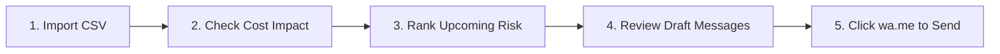

# ShowUp — Comprehensive User Guide

Welcome to **ShowUp**, the privacy-first, local-only desktop assistant designed to help solo service professionals (physiotherapists, remedial massage therapists, private tutors, hair stylists, driving instructors) reduce appointment no-shows.

---

## Table of Contents

1. [Quickstart & Workflow](#quickstart--workflow)
2. [Screen 1: Data Ingest & Column Mapping](#screen-1-data-ingest--column-mapping)
3. [Screen 2: Business Cost Dashboard](#screen-2-business-cost-dashboard)
4. [Screen 3: Upcoming Risk Rankings](#screen-3-upcoming-risk-rankings)
5. [Screen 4: Data-Grounded What-If Simulator](#screen-4-data-grounded-what-if-simulator)
6. [Screen 5: WhatsApp Review & Dispatch Hub](#screen-5-whatsapp-review--dispatch-hub)
7. [Screen 6: Ethical AI & Feature Audit](#screen-6-ethical-ai--feature-audit)
8. [Screen 7: Data Privacy & Complete Wipe](#screen-7-data-privacy--complete-wipe)
9. [Troubleshooting & FAQs](#troubleshooting--faqs)

---

## Quickstart & Workflow

ShowUp operates around a continuous five-step operational cycle:



### Starting the Application

- **Windows**: Double-click `scripts\run.bat` or run in terminal.
- **macOS / Linux**: Execute `./scripts/run.sh`.
- **Manual Launch**:
  ```bash
  streamlit run src/showup/ui/app.py
  ```
The desktop web interface will automatically open in your default browser at `http://localhost:8501`.

---

## Screen 1: Data Ingest & Column Mapping

Located under **`1_Import`** in the navigation sidebar.

### Importing Your Bookings
1. Export a booking CSV from your existing scheduling software (Fresha, Timely, Jane App, Acuity, Google Calendar export, or custom Excel spreadsheet).
2. Drag and drop your `.csv` file into the upload zone. ShowUp automatically sniffs the text encoding (UTF-8, ISO-8859-1, Windows-1252) and delimiter (comma, semicolon, tab).
3. If you want to explore the app without importing real data, click the **Generate Demo Data** button to load a synthetic clinic dataset.

### Intelligent Column Mapping
ShowUp features a fuzzy-matching column engine that maps your CSV headers to domain attributes:
- `client_id` or `client_name`
- `appointment_datetime`
- `service_type`
- `price`
- `deposit_paid`
- `confirmed`
- `outcome` (`attended`, `no_show`, or blank/pending for upcoming)

You can save your custom mapping profile for future one-click imports.

### Security Sanitization & Validation
- **Formula Injection Defense**: All cell values starting with formula characters (`=`, `+`, `-`, `@`) are automatically escaped to neutralize spreadsheet macro exploits.
- **Automatic Deduplication**: Duplicate bookings sharing the same client and timestamp are cleanly resolved without double-counting revenue.

---

## Screen 2: Business Cost Dashboard

Located under **`2_Dashboard`**.

### True Economic Impact
Unlike generic software that quotes hypothetical "industry averages," ShowUp computes every figure exclusively from your own verified historical appointments:
- **Historical No-Show Rate**: Percentage of past bookings marked as unexcused absences.
- **Estimated Lost Revenue**: Total monetary sum of missed appointments based on actual booked service fees.
- **Monthly Trend Breakdown**: Visual timeline of attendance trends over the last 6-12 months.
- **Sample Size Integrity**: Every metric displays the exact underlying count ($N$). If you have fewer than 10 historical records, ShowUp honestly reports that more data is required before computing trends.

### Background Scoring Worker
At the top of the dashboard, you can trigger the **Scoring Worker**. This kicks off a non-blocking background process that extracts behavioral features, runs time-ordered backtesting across heuristic rules, logistic regression, and TabPFN v2, and selects the most accurate model.

---

## Screen 3: Upcoming Risk Rankings

Located under **`3_Risk_Scores`**.

### Stratified Risk Bands
Upcoming appointments are ranked chronologically and categorized into three risk tiers:
- 🔴 **HIGH RISK** ($P(\text{no-show}) \ge 0.50$): Clients with prior unexcused absences, long lead times without deposits, or unconfirmed attendance.
- 🟡 **MEDIUM RISK** ($0.25 \le P(\text{no-show}) < 0.50$): New first-time clients booked on short notice.
- 🟢 **LOW RISK** ($P(\text{no-show}) < 0.25$): Reliable repeat clients with secured deposits and confirmed status.

### Transparent Explanations
Expand any booking card to view the exact probabilistic confidence score and the human-readable behavioral factors driving the prediction (e.g., *"14-day booking lead time without an upfront deposit"*).

---

## Screen 4: Data-Grounded What-If Simulator

Located under **`4_What_If`**.

ShowUp provides empirical answers to common business questions:
- *"Does taking a 20% deposit actually reduce no-shows in my clinic?"*
- *"Does sending confirmation requests improve my attendance rate?"*

### Honest Confounding Disclaimer
ShowUp stratifies your past bookings into:
1. Bookings secured with deposits vs bookings without deposits.
2. Bookings marked confirmed vs unconfirmed.

The interface presents the exact percentage point ($\Delta$) difference and sample sizes ($N_1$, $N_2$). If sample sizes are below 15, the card is hidden to prevent misleading decisions. A prominent note reminds owners that observational correlations can be confounded by client intent or service type.

---

## Screen 5: WhatsApp Review & Dispatch Hub

Located under **`5_Messages`**.

### Privacy-Preserving Local AI
ShowUp leverages **Gemma** running locally through **Ollama** on your computer. Your client records never leave your hard drive.

### The Human-in-the-Loop Principle
1. Select an upcoming booking.
2. ShowUp synthesizes a concise, friendly reminder tailored to the client's language preference (English, Hindi, Marathi):
   - Confirms the exact date, time, and service name.
   - Mentions clinic location details or cancellation policies.
3. **Automated Guardrails**: The output is screened locally against hallucinated figures, phone numbers, and forbidden phrases.
4. **Editable Preview**: You have complete freedom to tweak or reword the draft in a text box.
5. **Send via WhatsApp**: Clicking the **Send via WhatsApp** button opens a pre-populated `https://wa.me/<phone>?text=...` link in your browser or WhatsApp Desktop app. Nothing is ever automatically dispatched without your explicit action.

---

## Screen 6: Ethical AI & Feature Audit

Located under **`6_Feature_Audit`**.

ShowUp provides complete architectural transparency:
- **Allowed Features (14)**: Inspect the exact behavioral variables fed into scoring algorithms (e.g., `lead_time_hours`, `prior_no_shows`, `deposit_paid`).
- **Excluded Variables**: View the list of imported CSV columns that were permanently discarded (such as client names, addresses, or phone numbers) alongside the ethical and legal justification for their exclusion.

---

## Screen 7: Data Privacy & Complete Wipe

Located under **`7_Privacy`**.

### Local Storage Transparency
ShowUp displays the absolute filesystem path where your local SQLite database (`showup.db`), settings, and log files are stored. The database is protected with restricted OS permissions (0600 on POSIX, Owner-Only ACL on Windows).

### Irreversible Data Destruction
If you ever retire a clinic laptop or wish to reset your workspace:
1. Navigate to the Privacy screen.
2. Type `DELETE ALL DATA` into the confirmation field.
3. Click **Permanently Wipe Everything**.
ShowUp immediately severs all database connections, deletes the SQLite database, purges all cached features and logs, and restarts in a pristine clean state.

---

## Troubleshooting & FAQs

### Why is message drafting using templates instead of Gemma?
ShowUp looks for an Ollama server running locally at `http://localhost:11434`.
1. Ensure Ollama is installed and running (`ollama serve`).
2. Verify you have downloaded the Gemma model: `ollama pull gemma3:4b`.
3. If Ollama is offline, ShowUp gracefully uses built-in, culturally curated templates so your workflow is never interrupted.

### Can I run ShowUp on an airplane or without Wi-Fi?
Yes! ShowUp is built from the ground up as a **local-first** application. All metrics, scoring algorithms, and message drafting operate 100% offline. Outbound internet sockets are strictly disabled during pipeline runs.

### How do I update my model when new bookings happen?
Simply import your updated CSV at the end of each week or month and click **Run Scoring** on the Dashboard. ShowUp's time-ordered backtester will automatically incorporate the newest records into its rolling history.
